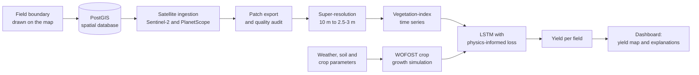

# VHR-YieldNet

Farm yield prediction for small fields using very high spatial resolution
satellite data.

## What the project does

Most farms in the study region are only a few hectares. Free Sentinel-2
imagery has 10 m pixels, so on a small field many pixels mix the crop with
field edges and neighbouring plots, and yield models built on them inherit
that noise. Purely statistical models also have no notion of how a crop
actually grows, so they can produce predictions that are biologically
impossible.

VHR-YieldNet addresses both problems:

- **Sharper imagery.** A super-resolution model upscales Sentinel-2 bands 4x,
  from 10 m to about 2.5–3 m, so that each field is described by its own
  pixels.
- **Biology-aware prediction.** An LSTM learns crop growth from the satellite
  time series and is constrained by the WOFOST crop growth model, so that
  predictions stay within what the crop can physically do.
- **Field-level results.** A web map lets a user draw a field boundary and is
  intended to show the predicted yield and stress zones for that field.

## How it works



### Workflow 1: Data assimilation

1. A field boundary is stored as a polygon in a PostGIS database through a
   Django REST API. Area and centroid are computed on save.
2. For each week of each growing season, Sentinel-2 scenes over the field are
   fetched from Google Earth Engine, cloud-masked and combined into one
   composite. The bands and three indices (NDVI, NDRE and a salinity index)
   are exported as a GeoTIFF.
3. PlanetScope 3 m scenes of the same field and dates are downloaded as the
   high-resolution reference.
4. Rasters are tiled into fixed-size patches and audited for readability,
   dimensions, band count and georeferencing.
5. Per-date statistics of each index are written to a CSV time series.

Code: [`cadastral/`](cadastral/), [`pipeline/`](pipeline/).

### Workflow 2: Spatial super-resolution

1. Exported patches are reviewed and unusable ones rejected.
2. The Red, Green, Blue and near-infrared bands are upscaled 4x by a deep
   learning model, either a pretrained SRGAN or a model trained on this
   project's Sentinel-2 / PlanetScope pairs.
3. Every result keeps the georeferencing of its input.
4. A validation step compares the result with the 10 m input, with plain
   bicubic upsampling and with the real 3 m image. Output is only meant to be
   used downstream when it passes.

Code and details: [`srgan/`](srgan/README.md).

### Workflow 3: Crop model and physics fusion

1. Daily weather for the season is downloaded from NASA POWER and converted
   to the format the crop model expects.
2. Soil, site, crop and sowing-date settings are assembled, and WOFOST (via
   the PCSE library) simulates daily crop development, leaf area, biomass and
   soil water.
3. The satellite time series and the WOFOST outputs are turned into
   fixed-length sequences for an LSTM.
4. The LSTM is to be trained with a physics-informed loss that penalises
   predictions which disagree with the crop model's biological limits.

Code: [`wofost/`](wofost/README.md), [`lstm/`](lstm/).

### Workflow 4: Dashboard

1. A React and Leaflet map lets the user draw or type in a field polygon.
2. The polygon is validated and saved through the REST API, and saved fields
   are drawn back onto the map.
3. Planned: clip the prediction grid to each polygon, sum the yield per
   field, and show yield heatmaps with SHAP-based explanations of crop stress.

Code: [`frontend/`](frontend/), [`config/`](config/).

## Repository layout

| Path | Contents |
| --- | --- |
| `cadastral/` | Django app: field boundary model, REST API, boundary ingestion command |
| `config/` | Django project settings and URL routing |
| `pipeline/` | Satellite download, patch export, time-series extraction, quality audit |
| `srgan/` | Super-resolution inference, training, validation and tests |
| `wofost/` | WOFOST crop simulation: weather, soil, site, crop calendar, diagnostics |
| `lstm/` | LSTM model and sequence preparation |
| `frontend/` | React + Leaflet field map |
| `weekly_reports/` | Automatically generated weekly progress reports |
| `generate_report.py` | Builds the weekly progress report from the git history |

## Technology

| Area | Tools |
| --- | --- |
| Frontend | React, Vite, Leaflet, OpenStreetMap |
| Backend | Django REST Framework, PostgreSQL with PostGIS |
| Satellite data | Google Earth Engine, PlanetScope, rasterio |
| Super-resolution | PyTorch |
| Crop modelling | PCSE / WOFOST, NASA POWER weather |
| Temporal model | PyTorch LSTM |

## Current status

| Workflow | State |
| --- | --- |
| Data assimilation | Working for one pilot field: database, API, weekly Sentinel-2 and PlanetScope ingestion, patch audit |
| Super-resolution | Inference, training and validation pipeline working; a model that passes the full validation is still in progress |
| Crop model and fusion | WOFOST runs with regional weather and soil; crop calibration, LSTM training and the physics-informed loss are not done yet |
| Dashboard | Field drawing and saving work; yield maps and explanations are not built yet |

The project does not produce yield predictions yet.

## Getting started

Python 3.10 or newer, Node.js, and a PostgreSQL database with the PostGIS
extension are required.

```powershell
# Backend
py -3 -m venv .venv
.venv\Scripts\activate
pip install -r requirements.txt
python manage.py migrate
python manage.py runserver

# Frontend
cd frontend
npm install
npm run dev

# Super-resolution module
pip install -r srgan/requirements-srgan.txt
python -m unittest srgan.test_srgan_pipeline
```

### Configuration

Settings are read from a local `.env` file, which is never committed. Create
your own with these variables:

| Variable | Used by | Purpose |
| --- | --- | --- |
| `SECRET_KEY`, `DJANGO_DEBUG`, `DJANGO_ALLOWED_HOSTS` | Django | Standard Django settings |
| `DB_NAME`, `DB_USER`, `DB_PASSWORD`, `DB_HOST`, `DB_PORT`, `DB_SSLMODE` | Django | PostGIS connection |
| `GDAL_LIBRARY_PATH`, `GEOS_LIBRARY_PATH` | Django | Location of the GDAL and GEOS libraries, if not found automatically |
| `PLANET_API_KEY` | `pipeline/` | PlanetScope downloads |
| `VITE_API_URL` | `frontend/.env` | Base address of the REST API |

Google Earth Engine and Google Drive access use your own Google credentials,
created locally on first run. Credentials, tokens, imagery, model weights and
database files are excluded from the repository by `.gitignore`.
